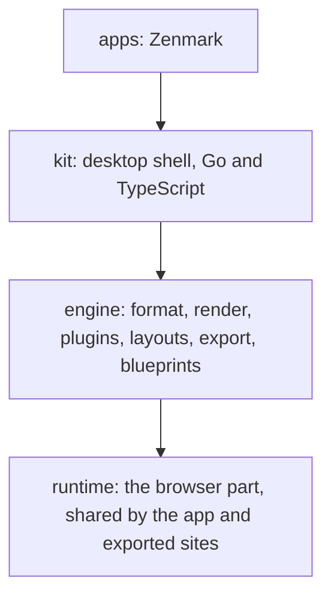

# How it works

This page explains how zenmd, the kit and Zenmark fit together, and why the
engine has no windows.

## The idea

zenmd is three layers, and imports only point down:

- **The engine** (`engine/`, `builtins/`, `runtime/`, the `zenmd` command) turns a folder into pages. It has no windows, menus or dialogs.
- **The kit** (`kit/desktop`, `kit/ui`) holds what every desktop app needs: windows, the sidebar, Settings, the editor.
- **The app** (`apps/zenmark`) is a main, a menu and its own features. Its `app-assembly.yml` lists which features, plugins, layouts, blueprints and dialects it includes.

## Why it is this way

- **One engine, many apps.** Everything that turns a folder into pages lives in zenmd, so a second app gets it for free.
- **CLI first.** Every option is a `zenmd` flag and a config key before it is a button, so scripts, CI and the app produce the same output.
- **The same output everywhere.** The app and `zenmd export site` use one build of the browser runtime, so an exported site looks like the app.

> **Missing:** the Go API for embedding the engine (`engine/session`), with an
> example. docs/wiki/ENGINE.md plans it for developers but it isn't written for
> readers yet.
