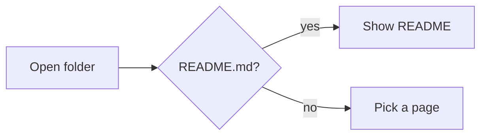

# diagram

Draws diagrams from a `mermaid` fence. A diagram follows the light or dark
theme. A wrong diagram keeps its source visible, with Mermaid's message under
it. On by default.

## Names

| Name | Written as |
|---|---|
| `mermaid` | a fence: ```` ```mermaid ```` |
| `diagram` | a container: `:::diagram`, and the same in MyST as ```` ```{diagram} ```` |

## Options

| Option | Default | What it does |
|---|---|---|
| `theme` | `neutral` | The Mermaid theme: `neutral`, `dark` or `default`. |

Set it in frontmatter, `.zenmd.yml` or Settings › Plugins. An option the plugin
does not know is ignored.

## Example

````markdown

````

## A diagram from a file

A diagram can live in its own file of the open folder, and a page draws it. Write
the path in any of three ways:

````markdown
```mermaid {file=diagrams/flow.mmd}
```

```mermaid diagrams/flow.mmd
```

```mermaid
:file: diagrams/flow.mmd
```
````

The same works for `:::diagram` and, in MyST, for ```` ```{mermaid} ````.

- A path that starts with `/` is from the folder's root (`/diagrams/flow.mmd`).
  Any other path is from the page's own folder, as a link is, and `..` may climb
  only as far as the root.
- A path with spaces goes in braces and quotes: `{file="my flows/a.mmd"}`.
- The file's name is not checked. `.mmd` and `.mermaid` are the usual ones.
- A file must be a text file of at most 1 MB, and a symlink must stay inside the
  folder. A file that cannot be read keeps an error box on the page and one
  warning (`zenmd check` and Problems list it).
- If the block has its own text too, the file wins and one warning says so. An
  empty file draws nothing and warns.
- The file's text is drawn as is, so keep secrets out of it: a built site
  carries it. The diagram is drawn the same in the app, the editor preview and
  an exported site. There is no flag or config key for the path.
- Zenmark does not reload the page when only the `.mmd` file changes; reload
  the page with ⌘R.
