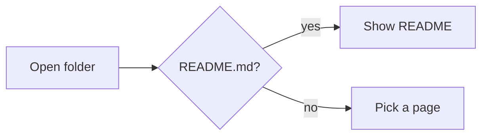

# diagram

Draws diagrams from a `mermaid` fence. A diagram follows the light or dark
theme. A wrong diagram keeps its source visible, with Mermaid's message under
it. On by default.

## Names

| Name | Written as |
|---|---|
| `mermaid` | a fence: ```` ```mermaid ```` |
| `diagram` | a container: `:::diagram`, and the same in MyST as ```` ```{diagram} ```` |

## Options

| Option | Default | What it does |
|---|---|---|
| `theme` | `neutral` | The Mermaid theme: `neutral`, `dark` or `default`. |

Set it in frontmatter, `.zenmd.yml` or Settings › Plugins. An option the plugin
does not know is ignored.

## Example

````markdown

````
