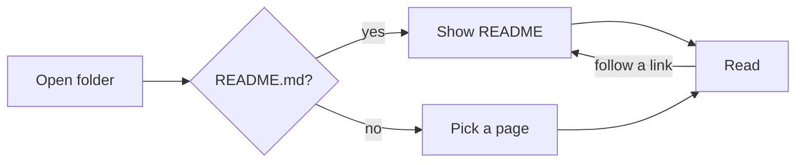
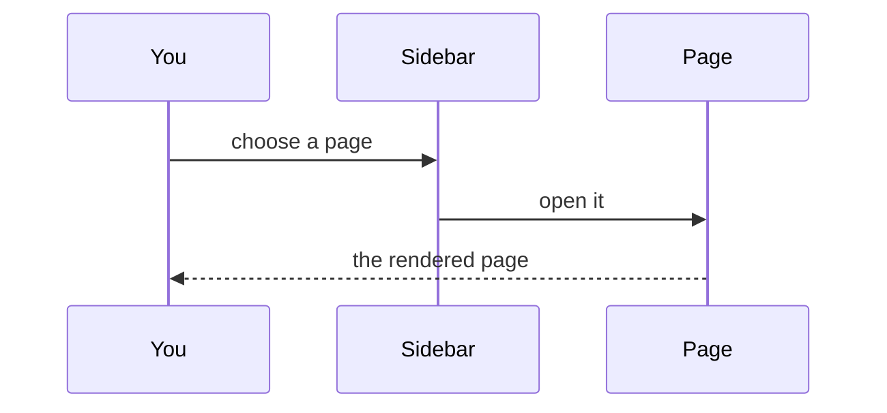
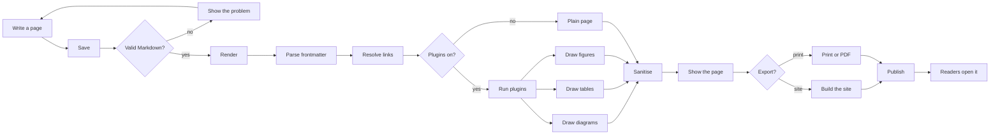

---
plugins:
  diagram: { theme: neutral }
---
# Diagrams

Write a ` ```mermaid ` block and Zenmark draws it. Diagrams follow the light or
dark theme.

## Flowchart



## Sequence



## A diagram from a file

A diagram can live in its own file. A path that starts with `/` is from the
folder's root; any other path is from this page's folder.

```mermaid
:file: /plugins/diagrams/flow.mmd
```

## Zoom and pan

A large diagram is shrunk to the reading column. Point at it (or Tab to it) to
get the controls in its corner: zoom in and out, reset, pan, and expand, which
opens it over the whole window. A pinch (or ⌘ or ⌃ with the wheel) zooms
around the pointer, and dragging pans once it is zoomed. With the figure
focused, `+`, `-` and `0` zoom and reset, the arrows pan, and Enter expands.



## When a diagram is wrong

The source stays visible with mermaid's error message under it:

```mermaid
graph TD
  A --> 
```

## Options

```yaml
plugins:
  diagram: { theme: neutral }   # neutral (default), default or dark
```
