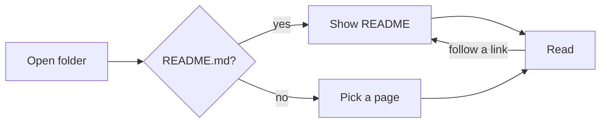
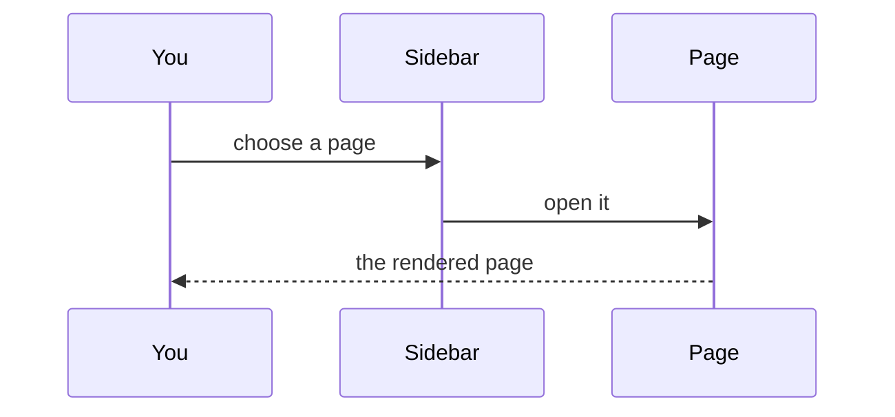

---
plugins:
  diagram: { theme: neutral }
---
# Diagrams

Write a ` ```mermaid ` block and Zenmark draws it. Diagrams follow the light or
dark theme.

## Flowchart



## Sequence



## A diagram from a file

A diagram can live in its own file. A path that starts with `/` is from the
folder's root; any other path is from this page's folder.

```mermaid
:file: /plugins/diagrams/flow.mmd
```

## When a diagram is wrong

The source stays visible with mermaid's error message under it:

```mermaid
graph TD
  A --> 
```

## Options

```yaml
plugins:
  diagram: { theme: neutral }   # neutral (default), default or dark
```
