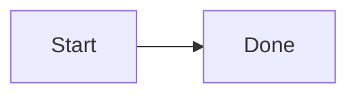

# Page templates

A **page template** is the structure of one kind of page: a how-to, a
release, a glossary term. It names the layout the page uses, the frontmatter
fields it needs, and the text a new page starts with, with the plugins that
text uses.

Page templates are YAML files, one `<id>.yml` each, found in three places:
the open folder's `.zen/templates/`, then `templates/pages/` in Zenmark's
settings folder, then the built-in ones. The first one found wins, so a
folder's own copy changes only that folder.

**Settings › Templates** lists them all, with where each comes from, its
fields, its structure and a preview of the page it starts.
**Copy to This Folder** puts a copy in `.zen/templates/` for you to edit.

## A whole file

```yaml
id: how-to                       # the file's name without .yml
name: How-to guide               # shown in Settings and New Page
description: Steps that get the reader to one result
version: 1.0.0                   # SemVer; used to update the built-in ones
layout: docs                     # the layout a new page gets

fields:                          # the page's frontmatter
  title:   { required: true }
  date:    { type: date, required: true, default: "{{today}}" }
  version: { type: string }

skeleton: |                      # the text a new page starts with
  # {{title}}

  One paragraph that names the task and what the reader will have done.

  ## Steps

  1. The first step
  2. The second step

structure:                       # the shape of the page, top to bottom
  - heading: { level: 1, count: 1 }
  - paragraph: { min: 1, max-words: 60, label: Summary }
  - section:
      heading: Steps
      contains: [ { list: ordered, min-items: 2 } ]
  - section: { heading: Troubleshooting, optional: true }
```

## The keys

| Key | What it does |
|---|---|
| `id` | The template's id, as in `template: how-to`. It is the file's name, so keep them the same. |
| `name` | Its name in Settings › Templates and New Page. |
| `description` | One line under the name. |
| `version` | A version such as `1.0.0`. Zenmark uses it to update the built-in ones. |
| `layout` | The [layout](../layouts/index.md) a new page gets, written to its frontmatter when it differs from the folder's. Without it, the page uses the folder's layout. |
| `fields` | The frontmatter fields a page of this kind has (see below). |
| `skeleton` | The text a new page starts with. Start it with `# {{title}}`: the H1 is the page's title. |
| `structure` | The shape of the page, top to bottom. Settings › Templates shows it as an outline. |

## `fields`

Each key is a frontmatter field.

| Option | What it does |
|---|---|
| `type` | `string` (the default), `date`, `image`, `list`, `bool` or `number`. |
| `required` | `true` when every page of this kind needs it. |
| `default` | The value a new page starts with. `{{today}}` is today's date. |

New Page writes each field that has a default into the new page's
frontmatter; the others are left for you to add. `title` becomes the page's
H1, never a `title:` field.

## The skeleton's placeholders

| Placeholder | Is replaced with |
|---|---|
| `{{title}}` | the title given in New Page |
| `{{today}}`, `{{date}}` | today's date |
| `{{folder}}` | the folder the page is made in |
| `{{version}}` | the version in the file's name, as in `v0.2.0.md` |
| a blueprint's question, such as `{{product}}` | the answer, when a blueprint writes the page |

A skeleton can hold any plugin block the page should start with, such as a
checklist or a diagram:

````markdown
## Before you start

- [ ] You have an account
- [ ] You have the latest version


````

## `structure`

Each line is one part of the page, in order:

| Part | Matches | Options |
|---|---|---|
| `heading` | a heading | `level`, `text`, `count`, `optional` |
| `section` | a heading and what follows, up to the next heading of its level | `heading`, `contains`, `optional`, `repeat` |
| `paragraph` | a paragraph | `min`, `max`, `max-words`, `label` |
| `list` | a list | `ordered`, `unordered` or `task`, `min-items`, `max-items` |
| `code` | a fenced code block | `lang` |
| `table` | a table | `min-rows`, `columns` |
| `image` | an image | `alt: required` |
| `block` | a plugin block, by name | `name`, `min`, `max` |
| `any` | anything | `min`, `max` |
| `end` | the end of the page, or of a `contains` list | none |

Settings › Templates shows the structure so you can see what a page of this
kind should hold. Checking pages against it is coming in a later version.

## Which template a new page starts from

In a folder made from a blueprint, `.zenmd.yml` maps folders to page
templates:

```yaml
templates:
  "how-tos/**": how-to
  "releases/**": release-notes
```

**New Page** in `how-tos/` then starts as a how-to. A page can say which
template it follows with `template: how-to` in its frontmatter, or
`template: false` to follow none.

## From a terminal

```sh
zenmd templates list            # every page template, where it comes from, its version
zenmd templates show how-to     # its fields, structure and skeleton
zenmd templates update how-to   # bring a built-in one to its newer version
zenmd templates --dir           # the templates folder (blueprints/, pages/)
```

Next: [Blueprints](blueprints.md), the collections of page templates that start a folder.
